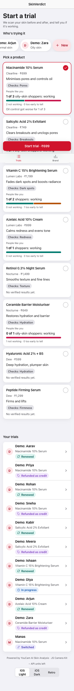
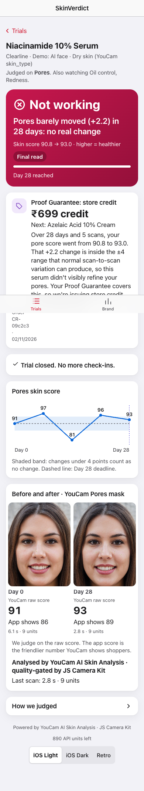

# SkinVerdict

**Is your skincare actually working?** SkinVerdict takes a baseline skin scan when you buy a product, re-scans you at check-ins, and gives a numeric verdict — *Working / Not yet / Not working* — on the one concern the product claims to fix. An agent then acts on it: reorders when it's working, holds when it's too early, swaps when it isn't.

Built on the **YouCam AI Skin Analysis API** (Perfect Corp) for the YouCam API Skin AI & eCommerce VTO Hackathon.

**Demo video (2:32):** https://youtu.be/RpIzEpALbzY

**Live demo:** https://skinverdict-gwjm7k5b2a-uc.a.run.app (resets to the demo data on each cold start; the AI-face trial is `#/trial/c8146f44226c96c9`)

<p>
  
  
</p>


## Why

Every skincare brand says it works. Nobody measures it. Subscriptions churn, reviews are vibes, and YouCam's own `ui_score` is documented as "adjusted to produce more favorable results". SkinVerdict tracks the underlying `raw_score` over time and turns it into:

- a shopper verdict with a published, deterministic rule set (`internal/verdict`), adherence-aware (scans after skipped use don't count),
- an agent action — reorder / hold / swap — instead of a nagging subscription,
- the **Proof Guarantee**: a high-confidence *not working* verdict settles the brand's money-back promise automatically as store credit — the scan is the arbitrator,
- **"People like you"** on the product page: verified outcomes among shoppers with the same skin profile (profile from YouCam `skin_type`, with an oiliness/moisture fallback),
- a **scan-verified review** ("Pores +9 raw points over 21 days"),
- a brand dashboard: which SKU fails for which skin profile, and how many guarantee credits it cost.

## Stack

Go 1.24 stdlib server · SQLite (pure-Go driver, no cgo) · single static binary · Preact + Vite front end embedded via `go:embed` · YouCam JS Camera Kit as the in-browser quality gate · in-process scheduler for check-ins.

## Run

```bash
cp .env.example .env && echo "YOUCAM_API_KEY=..." >> .env && set -a && . ./.env && set +a
make web                 # builds web/dist
CHECK_GAP=2m go run ./cmd/server          # http://localhost:8080
# dev loop: `make dev` + `cd web && npm run dev` (Vite on :5173, proxied)
```

Or `make build` → `bin/skinverdict` (static binary).

### Database

SQLite file at `data-local/skinverdict.db` (WAL mode), schema created on first start — see `internal/store/sql.go`. Override with `-db path` / `DB_PATH`; `-db json` switches to the dependency-free JSON store for quick experiments.

## Agent

`internal/agent` calls the **Claude Code CLI** headlessly (`claude -p … --output-format json`) — no API key, it uses the CLI's own login. The verdict is computed first and is final; the model only chooses among the actions the verdict allows (e.g. a high-confidence *not working* allows `refund_credit` or `swap`) and writes the shopper-facing reason. Any CLI failure or off-policy answer falls back to the deterministic `RuleAgent`, so check-ins never block. `AGENT=rules` disables the model entirely.

## Deploy (Cloud Run)

```bash
# once: store the key as a secret Cloud Run can read
gcloud secrets create skinverdict-youcam-key --data-file=-   # paste the key, then Ctrl-D
gcloud secrets add-iam-policy-binding skinverdict-youcam-key \
  --member=serviceAccount:<project-number>-compute@developer.gserviceaccount.com --role=roles/secretmanager.secretAccessor
# every release (the Dockerfile bakes the demo data from deploy/cloudrun/seed)
gcloud run deploy skinverdict --source . --region us-central1 --min-instances 0 --max-instances 1 \
  --allow-unauthenticated --memory 512Mi --set-secrets YOUCAM_API_KEY=skinverdict-youcam-key:latest
```

The disk is ephemeral, so each cold start begins from the baked demo data; the agent runs in `rules` mode (no Claude CLI login in the container).

## Deploy (VPS)

```bash
# on the VPS, once:
scp -r deploy user@vps:/tmp/ && ssh user@vps 'DOMAIN=skin.example.com sudo -E bash /tmp/deploy/setup.sh'
ssh user@vps 'sudo -u skinverdict tee /opt/skinverdict/.env <<<"YOUCAM_API_KEY=..."'
ssh -t user@vps 'sudo -iu skinverdict claude'      # log the CLI in once, then exit

# from your Mac, every release:
VPS=user@vps make deploy
```

Caddy terminates HTTPS for `DOMAIN` (Camera Kit needs a secure context) and proxies to the binary on 127.0.0.1:8080. Data (SQLite, scans, masks) lives in `/opt/skinverdict/data`.

## Flow

1. `POST /api/personas` → `POST /api/trials {persona_id, product_id}`
2. `POST /api/trials/{id}/scans` (multipart `image`, optional `at` for dated historical photos) → YouCam SD skin analysis on the product's target + guard concerns (9 units), masks persisted locally.
3. `GET /api/trials/{id}` → scans + verdict.
4. `POST /api/trials/{id}/checkin` → verdict + agent action. The scheduler calls the same path when `next_check` passes.
5. `GET /api/brand/cohorts[?by=profile]` → per-SKU (× skin profile) outcomes; `GET /api/products/{id}/outcomes?profile=oily` → "people like you".

## Verdict rules (default options)

| Rule | Value |
|---|---|
| Noise band on the target concern | ±4 raw points |
| Early win before day 14 | ≥ 8 points |
| Decision horizon (flat ⇒ not working) | 28 days |
| Side-effect flag on any guard concern | drop > 6 points |
| Change that counts (3+ scans) | only what first-vs-latest **and** the Theil–Sen trend agree on, so one outlier scan can't decide |

See `internal/verdict/verdict_test.go` for the cases.

## Building the 4-week timeline from photos you already have

```bash
# photos.csv:  path,YYYY-MM-DD
go run ./cmd/ingest -trial <id> -manifest photos.csv
```

Crop faces to ≥60% of image width first, or the API returns `error_src_face_too_small`.

## Demo data

- **"Demo: …" shoppers** (`go run ./cmd/seed`): synthetic score histories, so the brand dashboard has cohorts to show. Their scores are generated, not scanned.
- **"Demo: AI face"**: one face from thispersondoesnotexist.com (no real person), saved as five "selfies" that differ only in crop, tilt and exposure (`python3 samples/selfie_variants.py data-local/selfies`), dated a week apart and run through the real YouCam API. The skin is never edited, so the verdict it gets is whatever YouCam measured.
- **Live scans** in the app are real YouCam calls (9 units each).

## YouCam APIs used

- `skin-analysis` (SD concerns, `enable_mask_overlay`) — `internal/youcam/client.go`
- JS Camera Kit (`skincare` mode) — `web/src/camera.tsx`
